# Dossier Architektoniczne VSE dla Modelu Claude (Second-Opinion & Code Review)
**Temat:** Analiza regresji pipeline'u po wdrożeniu YouTube OAuth API v3 oraz Wtyczki WordPress v3.0 (Case study: `https://www.youtube.com/watch?v=ptOrFpUYa3Q`, 28m20s)  
**Projekt:** PressAI Video SEO Engine (`video-seo-engine`)  
**Autor analizy:** `vse-analyst-02` (w imieniu Supervisora `vse-architect-01`)  
**Data sporządzenia:** 2026-10-20  
**Status dokumentu:** Do recenzji architektonicznej przez model Claude (Second-Opinion)  
**Baza kodu:** commit `74e5218` (zbieżny na VPS, GitHub `main` i środowisku lokalnym)  

---

## SPIS TREŚCI
1. [Kontekst Biznesowy i Zgłoszenie Właściciela (Objawy Awarii)](#1-kontekst-biznesowy-i-zgłoszenie-właściciela-objawy-awarii)
2. [Twarde Dane Diagnostyczne (Baza Danych i Logi Produkcyjne VPS)](#2-twarde-dane-diagnostyczne-baza-danych-i-logi-produkcyjne-vps)
3. [Mapa Zmian Git z Ostatnich 3 Dni Wprowadzających Regresje](#3-mapa-zmian-git-z-ostatnich-3-dni-wprowadzających-regresje)
4. [Pięć Problemów Źródłowych (Analiza Kodu i Cytaty Źródeł)](#4-pięć-problemów-źródłowych-analiza-kodu-i-cytaty-źródeł)
   - [4.1. Problem 1: `clean_transcript` w Pass 1 LLM (Uderzenie w 8192 Tokenów i 200s Opóźnienia)](#41-problem-1-clean_transcript-w-pass-1-llm-uderzenie-w-8192-tokenów-i-200s-opóźnienia)
   - [4.2. Problem 2: Pass 2 Fallback Ignorujący Zwięzłość `watching_page` (Kolejne 97s Opóźnienia)](#42-problem-2-pass-2-fallback-ignorujący-zwięzłość-watching_page-kolejne-97s-opóźnienia)
   - [4.3. Problem 3: Pętla Ratunkowa Cloudflare 524 w `dashboard-inner.tsx` Serwująca Stary Wynik](#43-problem-3-pętla-ratunkowa-cloudflare-524-w-dashboard-innertsx-serwująca-stary-wynik)
   - [4.4. Problem 4: Cykl Życia `TranscriptJob` — Asymetria OAuth/Cache vs Runner i Nadpisywanie Bazy](#44-problem-4-cykl-życia-transcriptjob--asymetria-oauthcache-vs-runner-i-nadpisywanie-bazy)
   - [4.5. Problem 5: Regresja Publikacji Wtyczki WP v3.0 vs Dawny `run_inject`](#45-problem-5-regresja-publikacji-wtyczki-wp-v30-vs-dawny-run_inject)
5. [Proponowana Architektura Naprawy (Rekomendacje Wdrożeniowe)](#5-proponowana-architektura-naprawy-rekomendacje-wdrożeniowe)
6. [Pytania Kontrolne i Architektoniczne do Modelu Claude](#6-pytania-kontrolne-i-architektoniczne-do-modelu-claude)

---

## 1. Kontekst Biznesowy i Zgłoszenie Właściciela (Objawy Awarii)

### 1.1. Przebieg Zdarzeń i Intencja Użytkownika
Właściciel systemu (użytkownik konta agency `4b97ab0c-98ee-46c6-9be8-d86adc4cb38a`) przeprowadził testy generowania oraz publikacji materiału wideo dla filmu:
- **URL wideo:** `https://www.youtube.com/watch?v=ptOrFpUYa3Q`
- **Tytuł w YouTube:** `klimczak majchrowski` (materiał niepubliczny / unlisted, 28 minut 20 sekund)
- **Kanał YouTube:** `UCoH2G9By4OX3kcLsc8lHgDw` (*Studio Prawy_PL*, autoryzowany przez OAuth w tabeli `youtube_channels`)
- **Portal docelowy:** `Prawy.pl` (`portal_id = 2b047d7d-15a1-4d2f-8463-f89c2275bb73`, powiązany profil `prawy.yaml`)

**Intencja użytkownika:**
Użytkownik wygenerował materiał dwukrotnie, celowo zmieniając parametry:
1. Zamiast domyślnej pełnej analizy (`publication_type = "full_analysis"`), wybrał **"Strona filmu" (`publication_type = "watching_page"`)**, która zgodnie ze specyfikacją powinna zawierać krótki, zwięzły opis wideo (2-3 akapity, ~200-300 słów), odtwarzacz wideo oraz rozdziały i FAQ.
2. Zamiast formatu standardowego, w modalu publikacji wybrano format WordPress **🎬 Film (`post_format = "video"`)**.
3. Publikacja miała nastąpić bezpośrednio do portalu `prawy.pl` za pośrednictwem nowo wdrożonej Wtyczki WordPress v3.0 (`VSE WP Plugin v3.0`).

### 1.2. Zaobserwowane Objawy (Symptomy Błędów)
1. **Symptom 1: Bardzo długie oczekiwanie i pozorny brak działania:**
   Po kliknięciu „Generuj” w Dashboardzie, interfejs wchodził w stan ładowania trwający ponad 100 sekund (widoczny spinner bez aktualizacji statusu).
2. **Symptom 2: Brak śladu nowych przebiegów w historii zadań:**
   Na stronie `/historia` nie pojawiły się dwa nowe zadania. W tabeli widniał tylko jeden rekord sprzed wielu godzin.
3. **Symptom 3: Pokazanie starego wyniku zamiast nowego („Podstawienie przeszłości”):**
   Gdy interfejs wreszcie zakończył działanie i wyświetlił wynik jako gotowy, na ekranie pojawił się... **poprzednio wygenerowany materiał w formacie `full_analysis` (wielotysięczny długi artykuł analityczny ze starym tytułem i starą strukturą)**, całkowicie ignorując wybór formatu „Strona filmu”!
4. **Symptom 4: Wykastrowany post na Prawy.pl (Post ID `128625`):**
   Po wysłaniu wpisu do WordPressa przez wtyczkę v3.0:
   - Wpis utworzył się jako zwykły wpis tekstowy bez formatu wideo (`format` = standard zamiast `video`).
   - Brak miniatury wideo w bibliotece i jako `featured_media` (brak obrazka na stronie głównej prawy.pl).
   - Brak kategorii zdefiniowanych w profilu `prawy.yaml` (wpis trafił do domyślnej kategorii „Bez kategorii”).
   - Brak tagów i powiązanych screenshotów D11.
   - Treść zawierała wielostronicowy długi artykuł zamiast strony wideo.

---

## 2. Twarde Dane Diagnostyczne (Baza Danych i Logi Produkcyjne VPS)

Bezpośrednie zapytania do bazy danych PostgreSQL (`vse`) oraz logi kontenera `vse-api` na serwerze VPS ujawniły rzeczywisty przebieg zdarzeń, który całkowicie tłumaczy zachowanie systemu.

### 2.1. Rejestr Zużycia API (`usage_logs`) dla `ptOrFpUYa3Q`
Poniższa tabela przedstawia wszystkie wywołania dla filmu `ptOrFpUYa3Q` zarejestrowane w bazie:

| ID | Endpoint | Data i Czas (UTC) | publication_type | Tokens In | Tokens Out | Czas trwania | Koszt USD | Wynik |
|---|---|---|---|---|---|---|---|---|
| **29** | `/v1/generate` | 2026-10-20 15:53:17 | `full_analysis` | 20 181 | 12 857 | **322 s** (~5,3 min) | $0.253398 | Sukces |
| **28** | `/v1/generate` | 2026-10-20 15:53:44 | `watching_page` | 20 387 | 12 438 | **295 s** (~4,9 min) | $0.247731 | Sukces |
| **30** | `/v1/generate` | 2026-10-20 16:08:06 | `watching_page` | 20 435 | 11 784 | **279 s** (~4,6 min) | $0.238065 | Sukces |
| **31** | `/v1/generate` | 2026-10-20 17:16:13 | `watching_page` | 20 428 | 11 503 | **297 s** (~5,0 min) | $0.233829 | Sukces |
| **—** | `/v1/inject` | 2026-10-20 17:28:56 | `video` (modal) | — | — | **0.35 s** | — | WP Post `128625` |

> ⚠️ **Kluczowy fakt:** Backend pomyślnie przetworzył wszystkie 4 żądania! Żadne nie zwróciło błędu 500 w backendzie, a Claude wygenerował pełne odpowiedzi. Problem w tym, że każde z nich trwało **od 279 do 322 sekund**!

### 2.2. Stan Tabeli Zadań (`transcript_jobs`)
W tabeli `transcript_jobs` dla `video_url` zawierającego `ptOrFpUYa3Q` istnieje **DOKŁADNIE JEDEN WIERSZ**:

```sql
SELECT id, user_id, status, error, created_at, updated_at, portal_id, has_schema, transcript IS NOT NULL as has_transcript
FROM transcript_jobs WHERE video_url LIKE '%ptOrFpUYa3Q%';
```

Wynik z bazy:
- **`id`**: `5936f2b7-2cde-4069-a9ce-d2185ae8f642`
- **`status`**: `done`
- **`has_schema`**: `true`
- **`has_transcript`**: **`false` (`transcript IS NULL`)**
- **`created_at`**: `2026-10-20 15:58:39.405275+00`
- **`updated_at`**: `2026-10-20 17:21:10.593012+00` (zaktualizowany o 17:21:10 przy 4. przebiegu)

**Wnioski:**
1. Zamiast 4 osobnych rekordów w historii dla 4 generacji, istniał tylko jeden rekord, który był **wielokrotnie nadpisywany**.
2. W rekordzie tym pole `transcript` było równe `NULL`, mimo że transkrypcja została pomyślnie pobrana przez YouTube OAuth Data API v3.

### 2.3. Sekwencja Czasowa z Logów Kontenera `vse-api` (Przebieg z 16:08:06)
Oto dokładne wycinki z logów produkcyjnych dokumentujące rozbicie czasu na poszczególne etapy:

```text
2026-10-20 16:08:06,220 [INFO] api.routers.generate: [/v1/generate] video_url=https://www.youtube.com/watch?v=ptOrFpUYa3Q requested_provider=claude effective_provider=claude plan=agency type=watching_page portal_id=2b047d7d-15a1-4d2f-8463-f89c2275bb73 target_lang=pl ui_lang=pl
2026-10-20 16:08:06,221 [INFO] api.services.pipeline: [generate] video_id=ptOrFpUYa3Q is_audio=False provider=claude type=watching_page portal_id=2b047d7d-15a1-4d2f-8463-f89c2275bb73 target_lang=pl
2026-10-20 16:08:06,232 [INFO] api.services.pipeline: [pipeline] Loaded profile 'prawy': Prawy.pl
2026-10-20 16:08:06,350 [INFO] api.services.pipeline: [pipeline] Refreshed YT OAuth access_token for channel UCoH2G9By4OX3kcLsc8lHgDw (Studio Prawy_PL, user=4b97ab0c-98ee-46c6-9be8-d86adc4cb38a)
2026-10-20 16:08:06,743 [INFO] core.fetcher: [fetcher] API v3 OK: ptOrFpUYa3Q title='klimczak majchrowski' channel_id=UCoH2G9By4OX3kcLsc8lHgDw duration=PT28M20S views=1 lang=pl privacy=unlisted
2026-10-20 16:08:06,744 [INFO] api.services.pipeline: [generate] Priority 0 YT OAuth Captions: trying channel UCoH2G9By4OX3kcLsc8lHgDw (video_channel=UCoH2G9By4OX3kcLsc8lHgDw) for ptOrFpUYa3Q...
2026-10-20 16:08:07,187 [INFO] core.fetcher: [fetcher] API v3 captions OK: ptOrFpUYa3Q caption_id=AUieDabrfyzeHtG0NXJBJHuCxQMAhz3v9BQgXEeoJ43o9DYap4g lang=pl oauth=True (185212 chars)
2026-10-20 16:08:07,188 [INFO] api.services.pipeline: [generate] Priority 0 YT OAuth Captions succeeded via channel UCoH2G9By4OX3kcLsc8lHgDw (185212 chars)!
2026-10-20 16:08:07,322 [INFO] core.fetcher: [fetcher] D11 thumbnail 0: maxresdefault (ptOrFpUYa3Q, 178772 bytes)
2026-10-20 16:08:07,324 [INFO] api.services.pipeline: [generate] D11 thumbnails: 1 downloaded for ptOrFpUYa3Q (wanted 1)
2026-10-20 16:08:10,294 [INFO] core.generator: Processing video: ptOrFpUYa3Q (WP#0) via claude [type=watching_page, lang=pl->pl]

[... TUTAJ MINĘŁO DOKŁADNIE 194 SEKUNDY PRACY CLAUDE W PASS 1 ...]

2026-10-20 16:11:24,079 [INFO] core.generator:   -> https://www.youtube.com/watch?v=ptOrFpUYa3Q (Link do oryginalnego materiału wideo)

[... TUTAJ MINĘŁO DOKŁADNIE 81 SEKUND PRACY CLAUDE W PASS 2 ...]

2026-10-20 16:12:45,679 [INFO] api.services.pipeline: [pipeline] PressAI YT description received for ptOrFpUYa3Q
2026-10-20 16:12:45,680 [INFO] api.services.pipeline: [generate] done: video_id=ptOrFpUYa3Q ... type=watching_page images=1 has_transcript=True partial=False lang=pl->pl
```

Rozbicie czasowe:
- **Pobranie YouTube OAuth API v3:** `0.48 s` (od 16:08:06.744 do 16:08:07.187) — **błyskawiczne!**
- **Pobranie miniatur i metadanych:** `0.13 s`
- **Pass 1 (Główny prompt JSON w Claude):** **194 sekundy** (od 16:08:10 do 16:11:24)
- **Pass 2 (`_generate_article_fallback` dla HTML):** **81 sekund** (od 16:11:24 do 16:12:45)
- **Łączny czas przetwarzania:** **279 sekund (~4,6 minuty)**.

---

## 3. Mapa Zmian Git z Ostatnich 3 Dni Wprowadzających Regresje

W okresie od 17 do 20 października 2026 r. wprowadzono szereg commitów optymalizacyjnych i rozszerzających funkcjonalność. Trzy z nich wywołały kaskadę regresji:

### 3.1. Commit `87e21a3` — Wprowadzenie `clean_transcript` do Promptu Pass 1
- **Commit:** `87e21a3` (`fix(generator): hard anti-confabulation block on missing transcript, ASR phonetic correction instructions, and clean_transcript field [vse-dev-01]`)
- **Intencja:** Zapewnienie zredagowanego transkryptu z timestampami `[MM:SS]` do wyświetlania w nowej zakładce Dashboardu „Transkrypcja”.
- **Skutek uboczny:** Dodano punkt 18 do promptu Pass 1:
  ```python
  # core/generator.py linia 798:
  18. **clean_transcript** — zredagowany stylistycznie, interpunkcyjnie i ortograficznie zapis wypowiedzi z transkryptu, podzielony na czytelne akapity (oddzielone znakami \n\n) z zachowaniem timestampów co akapit w formacie `[MM:SS]`, oczyszczony z błędów fonetycznych ASR...
  ```
  Dla filmu 28-minutowego transkrypt liczy 32 000 znaków. Claude w Pass 1 zamiast zwięzłego JSON zaczął przepisywać cały tekst, uderzył w limit `max_tokens=8192`, generował odpowiedź przez 200 sekund, uciął JSON, co wymusiło interwencję `json-repair`.

### 3.2. Commit `4d0ed16` — Modyfikacja `_save_schema_to_job` i Asymetria Priority 0
- **Commit:** `4d0ed16` (`fix(generate): return HTTP 422 with 0 credits charged on missing transcript and reuse existing transcript job [vse-dev-01]`)
- **Intencja:** Zapobieganie tworzeniu duplikatów w tabeli `transcript_jobs` oraz zwracanie HTTP 422 przy braku transkryptu.
- **Skutek uboczny:** W `api/routers/generate.py` zmieniono filtr wyszukiwania joba:
  ```python
  # api/routers/generate.py linia 85:
  .where(TranscriptJob.status.in_(["fetched", "processing", "done", "cloud_fallback", "pending"]))
  ```
  Dodanie statusu `"done"` spowodowało, że jeśli dla danego filmu w bazie istniał już jakikolwiek wcześniejszy rekord (nawet sprzed kilku dni), funkcja **nigdy nie tworzyła nowego rekordu**, lecz nadpisywała stary. Jednocześnie przy pobraniu transkryptu przez YouTube OAuth Data API v3 (`Priority 0`) w `pipeline.py` **w ogóle nie jest tworzony rekord `TranscriptJob` na początku generowania** (tworzył go wyłącznie Local Runner w `Priority 2`).

### 3.3. Commity `f55f9bc` / `aa89413` / `1ab9775` — Nowa Ścieżka Publikacji Wtyczki WP v3.0
- **Intencja:** Zapewnienie publikacji bezpośredniej z Dashboardu do WordPressa przez token wtyczki (`POST /wp-json/vse/v1/publish`), eliminując konieczność konfigurowania haseł aplikacji WordPress (`wp_app_password`).
- **Skutek uboczny:** Funkcja `_inject_via_plugin_endpoint` w `api/routers/inject.py` oraz metoda PHP `rest_external_publish` we wtyczce `vse-video-seo.php`:
  - Całkowicie pominęły ładowanie profilu portalu (`prawy.yaml`).
  - Nie przekazują parametru `post_format` (wpis powstaje jako `standard` zamiast `video`).
  - Nie przekazują kategorii ani tagów (wpis trafia do „Bez kategorii”).
  - Nie pobierają ani nie ustawiają miniatury wpisu (`featured_media`).
  - Na sztywno wymuszają format `post_format="full_article"`.
  - W routerze wtyczki `api/routers/plugin.py` na sztywno wpisano `publication_type="full_analysis"`, uniemożliwiając generowanie „Strony filmu”.

---

## 4. Pięć Problemów Źródłowych (Analiza Kodu i Cytaty Źródeł)

### 4.1. Problem 1: `clean_transcript` w Pass 1 LLM (Uderzenie w 8192 Tokenów i 200s Opóźnienia)
**Plik:** [`core/generator.py`](file:///c:/Users/tomas2/.gemini/antigravity/playground/video-seo-engine/core/generator.py) (linie 798, 815, 1320–1327)

```python
# core/generator.py linia 798:
18. **clean_transcript** — zredagowany stylistycznie, interpunkcyjnie i ortograficznie zapis wypowiedzi z transkryptu, podzielony na czytelne akapity (oddzielone znakami \n\n) z zachowaniem timestampów co akapit w formacie `[MM:SS]`, oczyszczony z błędów fonetycznych ASR (skoryguj nazwiska i nazwy własne zgodnie z tytułem filmu: {title}) oraz wypełniaczy typu 'yyy', 'eee'.

# core/generator.py linia 815 (schemat JSON):
{{"focus_keyphrases":["fraza glowna","fraza 2","fraza 3"],"post_title":"...","seo_title":"...","yt_title":"...","meta_description":"...","lead":"...","quotes":[{{"text":"...","speaker":"...","anchor_text":"..."}}],"chapters":[{{"label":"...","anchor_text":"..."}}],"faq":[{{"question":"...","answer":"..."}}],"youtube_description_hook":"...","youtube_hashtags":["..."],"video_description":"...","tags":["..."],"external_links":[{{"url":"...","anchor_text":"...","reason":"..."}}],"image_descriptions":[{{"alt_text":"...","caption":"...","context":"..."}}],"clean_transcript":"[00:00] Zredagowany akapit 1...\n\n[02:15] Zredagowany akapit 2..."}}
```

**Dlaczego to błąd architektoniczny?**
1. Model Claude otrzymuje polecenie przepisania kilkunastu stron transkryptu wewnątrz jednego pola JSON. Generowanie przy prędkości ~35-40 tokenów/s zajmuje **od 190 do 210 sekund**.
2. Odpowiedź przekracza limit `max_tokens = 8192` w `client.messages.create()`, urywając JSON.
3. **W kodzie już istnieje gotowa, natychmiastowa alternatywa:**
   W [`core/generator.py`](file:///c:/Users/tomas2/.gemini/antigravity/playground/video-seo-engine/core/generator.py) linie 197–235 funkcja `build_clean_transcript_from_segments(segments: list[tuple[float, str]], interval_sec: float = 45.0) -> str` realizuje to zadanie w **2 milisekundy w czystym Pythonie**:
   - Usuwa wypełniacze ASR (`yyy`, `eee`, `mhm`),
   - Dzieli tekst na akapity z timestampami `[MM:SS]` co 45 sekund,
   - Formatowanie interpunkcyjne.
   Co więcej, w linii 1325 istnieje już fallback:
   ```python
   llm_clean_tr = (result.get("clean_transcript") or "").strip()
   if len(llm_clean_tr) >= 50:
       result["clean_transcript"] = llm_clean_tr
   else:
       result["clean_transcript"] = build_clean_transcript_from_segments(segments)
   ```
   Wymuszanie tego na Claude w Pass 1 generuje gigantyczny koszt tokenowy i 3,5 minuty bezużytecznego opóźnienia.

---

### 4.2. Problem 2: Pass 2 Fallback Ignorujący Zwięzłość `watching_page` (Kolejne 97s Opóźnienia)
**Plik:** [`core/generator.py`](file:///c:/Users/tomas2/.gemini/antigravity/playground/video-seo-engine/core/generator.py) (linie 406–443)

Gdy Pass 1 się kończy, system uruchamia Pass 2 w celu wygenerowania treści HTML artykułu:
```python
def _generate_article_fallback(
    schema: dict,
    vtt_text: str,
    publication_type: str,
    api_key: str,
    provider: str = "gemini",
    target_words: int = 800,
    target_lang: str = "pl",
    source_lang: str = "auto",
) -> str:
    keyphrase = schema.get("focus_keyphrases", [""])[0] if schema.get("focus_keyphrases") else ""
    instruction = FORMAT_INSTRUCTIONS.get(publication_type, FORMAT_INSTRUCTIONS["full_analysis"])
    ...
    prompt = f"""Jesteś doświadczonym redaktorem portalu. Napisz kompletny artykuł na podstawie transkryptu wideo.
...
FORMAT: {instruction}
CEL DŁUGOŚCI: minimum {target_words} słów

ZASADY HTML:
- Używaj <h2>, <h3>, <p>, <blockquote> (NIE <html>, <head>, <body>)
- Apostrofy (') w atrybutach HTML, NIE cudzysłowy
- Co 150-200 słów nowy nagłówek <h3> (w języku {lang_name})
- Na końcu sekcja podsumowania z nagłówkiem <h2>{summary_heading}</h2>
..."""
```

Dla `publication_type = "watching_page"`:
- `_get_target_words("watching_page")` zwraca `400`.
- `FORMAT_INSTRUCTIONS["watching_page"]` to: *"Napisz krótki opis wideo (2-3 akapity). Styl: informacyjny."*
- **Sprzeczność w prompcie:** Prompt nakazuje jednocześnie: *"Napisz krótki opis wideo (2-3 akapity)"*, ale poniżej twardo wymusza: *"CEL DŁUGOŚCI: minimum 400 słów"*, *"Co 150-200 słów nowy nagłówek <h3>"* oraz *"Na końcu sekcja podsumowania z nagłówkiem <h2>Podsumowanie</h2>"*.
- Claude traktuje słowo „minimum” dosłownie i generuje pełny, długi artykuł analityczny na 9336 znaków (~1300 słów) z wieloma nagłówkami H3, co zajmuje kolejne **97 sekund**!
- Łączny czas generowania: 194s (Pass 1) + 97s (Pass 2) = **291 sekund**.

---

### 4.3. Problem 3: Pętla Ratunkowa Cloudflare 524 w `dashboard-inner.tsx` Serwująca Stary Wynik
**Plik:** [`web/src/app/dashboard/dashboard-inner.tsx`](file:///c:/Users/tomas2/.gemini/antigravity/playground/video-seo-engine/web/src/app/dashboard/dashboard-inner.tsx) (linie 471–505)

Ponieważ Cloudflare posiada twardy limit timeoutu na poziomie **100 sekund**, każde zapytanie trwające >100s jest przerywane przez serwer proxy błędem **HTTP 524 Gateway Timeout**.
W frontendzie wprowadzono „pętlę ratunkową”, która miała odpytywać historię zadań, czekając aż backend zakończy pracę w tle:

```typescript
// web/src/app/dashboard/dashboard-inner.tsx linie 471-505:
} catch (genErr: unknown) {
  const msg = genErr instanceof Error ? genErr.message : String(genErr)
  // Polling awaryjny przy timeoutach Cloudflare / Nginx 504/524/502
  if (msg.includes('504') || msg.includes('524') || msg.includes('502') || msg.includes('Gateway')) {
    const vid = extractVideoId(url.trim())
    if (vid) {
      for (let attempt = 0; attempt < 25; attempt++) {
        await new Promise((r) => setTimeout(r, 4000))
        try {
          const hist = await apiGet<Array<{ id: string; video_id?: string; video_url?: string; status: string; has_schema?: boolean }>>('/v1/jobs/history?limit=10')
          const match = Array.isArray(hist)
            ? hist.find((j) => (j.video_id === vid || (j.video_url && j.video_url.includes(vid))) && (j.status === 'done' || j.has_schema))
            : undefined
          if (match?.id) {
            const fullJob = await apiGet<{ id: string; video_id?: string; video_url: string; schema_data?: SchemaData }>(`/v1/jobs/${match.id}`)
            if (fullJob?.schema_data) {
              data = {
                status: 'ok',
                video_id: fullJob.video_id || vid,
                processing_time_s: 0,
                schema_data: fullJob.schema_data,
                source_lang: (fullJob.schema_data.source_lang as string) || 'pl',
                target_lang: (fullJob.schema_data.target_lang as string) || effectiveTargetLang,
              }
              break
            }
          }
        } catch {
          // kontynuuj polling
        }
      }
    }
  }
  if (!data) throw genErr
}
```

**Błąd krytyczny w logice (Root Cause symptomu 3):**
1. Warunek wyszukiwania: `hist.find((j) => (j.video_id === vid ...) && (j.status === 'done' || j.has_schema))`.
2. Kod **nie sprawdza, kiedy job został utworzony**! Nie porównuje `created_at` z czasem wysłania zapytania (`requestStartTime`).
3. Gdy po 100 sekundach Cloudflare zwraca błąd 524, kod natychmiast pyta `/v1/jobs/history?limit=10`.
4. W historii znajduje rekord `5936f2b7...` dla filmu `ptOrFpUYa3Q` ze statusem `done` **pochodzący z poprzedniej generacji (np. sprzed godziny lub dnia)**!
5. Skrypt natychmiast uznaje zadanie za zakończone sukcesem, pobiera stare `schema_data` (gdzie zapisana była pełna analiza `full_analysis`) i wstrzykuje do interfejsu.
6. Użytkownik widzi sukces i starą analizę, podczas gdy backend w tle na serwerze nadal liczy nową wersję (do 297 sekundy) i dopiero po 3 minutach nadpisuje bazę!

---

### 4.4. Problem 4: Cykl Życia `TranscriptJob` — Asymetria OAuth/Cache vs Runner i Nadpisywanie Bazy
**Pliki:** [`api/services/pipeline.py`](file:///c:/Users/tomas2/.gemini/antigravity/playground/video-seo-engine/api/services/pipeline.py) (linie 908–940) oraz [`api/routers/generate.py`](file:///c:/Users/tomas2/.gemini/antigravity/playground/video-seo-engine/api/routers/generate.py) (linie 74–119)

**Jak działała architektura przed zmianami (gdy wszystko szło przez Local Runnera)?**
1. Na początku generowania Local Runner tworzył rekord `TranscriptJob` w bazie (`status = "pending"`).
2. Po pobraniu transkryptu status zmieniał się na `"fetched"`.
3. Podczas pracy LLM w bazie istniał aktywny rekord z unikalnym ID.
4. Po zakończeniu generowania `_save_schema_to_job` szukał rekordu w stanie `fetched` / `processing`, wstawiał `schema_data` i zmieniał status na `"done"`.

**Co zepsuło wdrożenie Priority 0 (YouTube OAuth Data API v3)?**
Spójrzmy na kod w `api/services/pipeline.py`:
```python
# Priority 0: Try OAuth Captions across user's authorized channels
if channel_tokens:
    for ch_id, tok in channel_tokens:
        oauth_vtt, oauth_lang = await asyncio.to_thread(
            fetch_transcript_api_v3, video_id, resolved_target_lang, yt_api_key, tok
        )
        if oauth_vtt and len(oauth_vtt.strip()) >= 50:
            matched_access_token = tok
            logger.info("[generate] Priority 0 YT OAuth Captions succeeded via channel %s (%d chars)!", ch_id, len(oauth_vtt))
            break

if oauth_vtt and len(oauth_vtt.strip()) >= 50:
    vtt_path = str(pathlib.Path(tmp_dir) / f"{video_id}.{oauth_lang or resolved_target_lang}.vtt")
    pathlib.Path(vtt_path).write_text(oauth_vtt, encoding="utf-8")
    meta["vtt_path"] = vtt_path
```
- Gdy OAuth Captions (`Priority 0`) lub DB Cache (`Priority 1`) pobiorą transkrypcję, **ŻADEN rekord `TranscriptJob` nie jest tworzony w bazie**! Napisy zapisywane są tylko do pliku tymczasowego na dysku w kontenerze.
- Przez cały czas trwania generowania (5 minut) w bazie danych **nie ma żadnego śladu, że trwa jakiekolwiek przetwarzanie**!
- Gdy generowanie wreszcie dobiega końca, wywoływana jest funkcja `_save_schema_to_job`:
```python
# api/routers/generate.py linie 74-119:
async def _save_schema_to_job(video_url: str, schema_data: dict, portal_id: Optional[str] = None, user_id: Optional[str] = None) -> None:
    ...
    result = await db.execute(
        select(TranscriptJob)
        .where(TranscriptJob.video_url.contains(vid_key))
        .where(TranscriptJob.status.in_(["fetched", "processing", "done", "cloud_fallback", "pending"]))
        .order_by(desc(TranscriptJob.transcript.isnot(None)), desc(TranscriptJob.created_at))
        .limit(1)
    )
    job = result.scalar_one_or_none()
    if job:
        job.schema_data = schema_data
        job.portal_id = portal_id
        job.status = "done"
        logger.info(
            "[generate] Saved schema_data to existing job %s (status=done, has_transcript=%s)",
            job.id, bool(job.transcript),
        )
```
- Ponieważ dodano status `"done"` do zapytania, funkcja nie tworzy nowego rekordu, lecz znajduje poprzedni stary rekord i go bezpowrotnie nadpisuje!
- Z tego powodu w bazie na zawsze pozostaje tylko 1 rekord, historia ulega zatarciu, a pole `transcript` w bazie ma wartość `NULL` (bo w starym rekordzie transkryptu nie było, a nowy pobrany przez OAuth nie został do kolumny `transcript` przepisany).

---

### 4.5. Problem 5: Regresja Publikacji Wtyczki WP v3.0 vs Dawny `run_inject`
**Pliki:** [`api/routers/inject.py`](file:///c:/Users/tomas2/.gemini/antigravity/playground/video-seo-engine/api/routers/inject.py) (linie 52–180), [`api/routers/plugin.py`](file:///c:/Users/tomas2/.gemini/antigravity/playground/video-seo-engine/api/routers/plugin.py) (linia 773) oraz [`plugins/vse-video-seo/vse-video-seo.php`](file:///c:/Users/tomas2/.gemini/antigravity/playground/video-seo-engine/plugins/vse-video-seo/vse-video-seo.php) (linie 1119–1200)

Po wdrożeniu wtyczki WP v3.0 publikacja z Dashboardu zaczęła korzystać z funkcji `_inject_via_plugin_endpoint`. Spowodowało to utratę kluczowych funkcjonalności wypracowanych we wcześniejszych fazach projektu.

Porównanie bezpośrednie implementacji:

| Właściwość / Funkcjonalność | Wcześniejsza implementacja (`run_inject` w `pipeline.py` + `core/injector.py`) | Nowa implementacja (`_inject_via_plugin_endpoint` + wtyczka v3.0) |
|---|---|---|
| **Metoda autoryzacji** | `wp_app_password` (WordPress REST API v2) | Token wtyczki `X-VSE-Key-Hash` do `/wp-json/vse/v1/publish` |
| **Profil portalu (`profiles/prawy.yaml`)** | **TAK** — ładuje konfigurację profilu, dedykowane klasy CSS rozdziałów, selektory odtwarzacza, brand | **BRAK** — profil portalu jest całkowicie ignorowany |
| **Kategorie wpisu (`categories`)** | **TAK** — wstrzykuje kategorie z profilu (np. `[2, 2472]` Polska + Prawy TV) | **BRAK** — pole `categories` nie jest wysyłane w payloadzie; wpis trafia do „Bez kategorii” |
| **Format wpisu w WordPressie (`post_format`)** | **TAK** — przekazuje `format: post_format` (`video`), co uruchamia dedykowany player motywu | **BRAK** — payload nie zawiera formatu, a w PHP brak wywołania `set_post_format()`. Wpis jest zwykłym postem `standard` |
| **Miniatura wpisu (`featured_media`)** | **TAK** — pobiera miniatury YT w najwyższej rozdzielczości, wgrywa do WP Media Library i ustawia jako `featured_media` z ALT | **BRAK** — miniatura w ogóle nie jest przesyłana ani wgrywana do mediów WordPressa |
| **Format artykułu HTML** | Dynamiczny w zależności od typu publikacji | **Zaszyty na sztywno:** `post_format="full_article"` (linia 109 `inject.py`) |
| **Typ publikacji w routerze wtyczki** | Przekazywany w zapytaniu | **Zaszyty na sztywno:** `publication_type="full_analysis"` (linia 773 `plugin.py`) |
| **Model żądania wtyczki (`InjectDataRequest`)** | N/A | **Brak pola:** `InjectDataRequest` w ogóle nie posiada pola `publication_type` ani `post_format` |

**Dlaczego wpis 128625 na Prawy.pl jest wybrakowany?**
Wpis 128625 opublikowany przez `_inject_via_plugin_endpoint` nie ma formatu `video`, nie ma miniatury na liście wpisów portalu, wpadł do domyślnej kategorii i zawiera pełny artykuł, ponieważ endpoint `/wp-json/vse/v1/publish` we wtyczce PHP oraz router `inject.py` nie obsługują tych pól!

---

## 5. Proponowana Architektura Naprawy (Rekomendacje Wdrożeniowe)

Dla każdego z pięciu problemów przedstawiamy konkretne, bezpieczne rozwiązanie architektoniczne do wdrożenia:

```mermaid
flowchart TD
    subgraph KROK 1 & 2: Optymalizacja Generatora
        A["YouTube OAuth / Cache"] --> B["Pass 1: Schema JSON (Tylko metadane, SEO, FAQ, Rozdziały)"]
        B -.->|"USUNIĘTO clean_transcript z promptu"| B1["Zysk: 15s zamiast 200s!"]
        A --> C["build_clean_transcript_from_segments (Lokalny Python)"]
        C -->|"0 tokenów, 2 ms"| D["clean_transcript gotowy w pamięci"]
        B & D --> E{"Typ publikacji?"}
        E -->|"watching_page"| F["Pass 2 Zwięzły: max 2 akapity, zakaz H3 (Zysk: 8s zamiast 97s!)"]
        E -->|"full_analysis"| G["Pass 2 Analityczny: pełny artykuł"]
    end

    subgraph KROK 3 & 4: Cykl Życia Zadań i Odporność na Timeouty
        H["Start run_generate()"] --> I["ZAWASZE utwórz nowy TranscriptJob (status='processing')"]
        I --> J["Zapisz pobrany transkrypt do job.transcript"]
        J --> K["Wykonaj LLM (łącznie ~20-25s)"]
        K --> L["Zapisz schema_data i status='done' do TEGO SAMEGO job_id"]
        M["Dashboard Poll (w razie błędu 524)"] --> N["Sprawdzaj TYLKO joby z created_at >= requestStartTime"]
    end

    subgraph KROK 5: Ujednolicenie Publikacji Wtyczki WP v3.0
        O["Dashboard Inject Modal"] --> P["_inject_via_plugin_endpoint"]
        P --> Q["Załaduj profil YAML portalu (prawy.yaml)"]
        Q --> R["Dołącz do payloadu: post_format, categories, tags, thumbnail_url"]
        R --> S["Wtyczka PHP: set_post_format(), wp_set_post_categories(), set_post_thumbnail()"]
    end
```



### 5.1. KROK 1: Usunięcie `clean_transcript` z Promptu LLM Pass 1
- **Działanie:** Usunąć punkt 18 z promptu `generate_seo_v4()` w `core/generator.py` oraz z przykładowego schematu JSON.
- **Implementacja:** W `process_video()` pole `result["clean_transcript"]` ma być generowane **zawsze i wyłącznie w Pythonie** przez istniejącą funkcję `build_clean_transcript_from_segments(segments)`.
- **Zysk:** Czas Pass 1 spadnie z **200 sekund do ~15 sekund** (z 8192 tokenów wyjściowych do ~1200 tokenów). Zniknie ucinanie JSON i błędy `json-repair`.

### 5.2. KROK 2: Dedykowany, Zwięzły Prompt Pass 2 dla `watching_page`
- **Działanie:** W `core/generator.py` w `_generate_article_fallback()` dodać dedykowaną gałąź dla `watching_page`:
  ```python
  if publication_type == "watching_page":
      prompt = f"""Jesteś redaktorem portalu wideo. Napisz krótki, zwięzły opis materiału wideo w języku {lang_name}.
WYMOGI STRUKTURY:
- DOKŁADNIE 2 krótkie akapity tekstu (łącznie 150-250 słów).
- Akapit 1: O czym jest film, kto występuje, główna teza.
- Akapit 2: Kluczowe wnioski lub dlaczego warto obejrzeć.
- BEZWZGLĘDNY ZAKAZ tworzenia nagłówków <h2>, <h3> ani sekcji podsumowania (tekst towarzyszy odtwarzaczowi wideo).
- Używaj wyłącznie tagów <p> (atrybuty w apostrofach)."""
  ```
- **Zysk:** Czas Pass 2 dla „Strony filmu” spadnie z **97 sekund do ~6-8 sekund**.
- **Łączny czas generowania `watching_page` wyniesie ~20-25 sekund** — znacznie poniżej 100-sekundowego limitu Cloudflare!

### 5.3. KROK 3: Naprawa Pętli Ratunkowej w `dashboard-inner.tsx`
- **Działanie:** W `web/src/app/dashboard/dashboard-inner.tsx` zapisać timestamp startu żądania:
  `const requestStartTime = Date.now()`
- W pętli ratunkowej (obsługa 524/504):
  Filtrować zadania z historii:
  ```typescript
  const jobCreatedAt = new Date(j.created_at).getTime()
  if (jobCreatedAt < requestStartTime - 5000) {
      // Ignoruj zadania utworzone przed wysłaniem obecnego formularza!
      return false
  }
  ```
- Jeśli świeże zadanie nie istnieje lub ma status `processing`, czekać na jego zakończenie. Nigdy nie serwować starych zadań sprzed godzin/dni.

### 5.4. KROK 4: Ujednolicenie Cyklu Życia `TranscriptJob` na Backendzie
- **Działanie 1:** Na samym początku `run_generate()` w `api/services/pipeline.py` ZAWSZE tworzyć nowy rekord `TranscriptJob`:
  ```python
  job = TranscriptJob(
      video_url=video_url,
      status="processing",
      portal_id=portal_id,
      user_id=uuid.UUID(user_id) if user_id else None,
  )
  db.add(job)
  await db.commit()
  await db.refresh(job)
  job_id = job.id
  ```
- **Działanie 2:** Po pobraniu transkrypcji (przez OAuth, Cache lub Runnera), zapisać ją do rekordu `job.transcript = vtt_content` oraz `job.status = "fetched"`.
- **Działanie 3:** W `_save_schema_to_job` przekazywać konkretny `job_id` zamiast wyszukiwać po URL i statusie `"done"`. Zaktualizować ten konkretny job do `status = "done"`, `schema_data = schema_data`.

### 5.5. KROK 5: Ujednolicenie Publikacji Wtyczki WP v3.0 z `run_inject`
- **Działanie 1 (`api/routers/inject.py`):**
  W `_inject_via_plugin_endpoint`:
  - Załadować profil portalu `profile_config = _load_profile_config(portal.profile_id)`.
  - Odczytać domyślne kategorie z profilu (np. `[2, 2472]` dla prawy.pl).
  - Przekazać do payloadu: `post_format` (z `req.post_format`, np. `"video"`), `categories`, `tags` oraz `thumbnail_url` (z `seo.get("image_data")` lub miniatury YT).
  - W `build_wp_post_html` przekazywać rzeczywisty format wpisu zamiast sztywnego `"full_article"`.
- **Działanie 2 (`plugins/vse-video-seo/vse-video-seo.php`):**
  W metodzie `rest_external_publish`:
  - Obsłużyć `post_format`: wywołać `set_post_format( $post_id, $post_format )`.
  - Obsłużyć `categories`: wywołać `wp_set_post_categories( $post_id, $categories )`.
  - Obsłużyć `thumbnail_url`: pobrać obrazek przez `download_url()`, wgrać do biblioteki mediów i wywołać `set_post_thumbnail( $post_id, $attach_id )` z odpowiednim tagiem ALT.
- **Działanie 3 (`api/routers/plugin.py`):**
  - Dodać pole `publication_type: Optional[str] = "full_analysis"` do `InjectDataRequest`.
  - W wywołaniu `run_generate` przekazywać `publication_type=req.publication_type`.

---

## 6. Pytania Kontrolne i Architektoniczne do Modelu Claude

Prosimy model Claude o przeprowadzenie wnikliwej recenzji powyższego dossier i ustosunkowanie się do następujących dylematów architektonicznych:

### Pytanie 1: Cykl Życia `TranscriptJob` a Wielokrotne Generowanie (History Item vs Job)
Czy encja `TranscriptJob` powinna pełnić jednocześnie rolę:
a) kolejki asynchronicznej transkrypcji dla Local Runnera,
b) wpisu w historii generacji użytkownika,
c) cache transkryptów?
Czy nie należałoby rozdzielić tych odpowiedzialności na dwie tabele:
- `transcript_cache` (unikalny klucz `video_id`, surowy transkrypt VTT, język, data pobrania),
- `generation_jobs` / `seo_articles` (rekord per kliknięcie „Generuj”, ze statusem, parametrami `publication_type`, `portal_id`, `schema_data` i timestampami)?
Jak Claude ocenia ryzyko takiego refaktoringu w obecnej fazie projektu?

### Pytanie 2: Architektura Obsługi Długich Requestów wobec Limitu Cloudflare 100s
Nawet przy skróceniu czasu do 20-25s dla `watching_page`, pełna analiza (`full_analysis`) dla filmów 2-godzinnych może w przyszłości zająć 60-90s, zbliżając się do limitu Cloudflare 100s.
Mamy w kodzie gotowy endpoint SSE `POST /v1/generate/stream` (commity `87e21a3`/`4d0ed16`) oraz polling asynchroniczny `job_id`.
Które podejście jest bardziej stabilne w architekturze Next.js 14 + Cloudflare + FastAPI:
- Pełna migracja Dashboardu na Server-Sent Events (SSE) `/v1/generate/stream`,
- Architektura oparta na natychmiastowym zwrocie `{ "job_id": "uuid" }` (HTTP 202 Accepted) i odpytywaniu GET `/v1/jobs/{id}` co 2 sekundy przez frontend?

### Pytanie 3: Duplikacja Logiki Publikacji — Integracja Wtyczki v3.0 vs `core/injector.py`
W kodzie powstały równolegle dwa silniki publikacji:
1. `core/injector.py` (`inject_video` + `_create_wp_post` przez WordPress REST API v2 + Application Passwords) — kompletny, dopracowany (D1-D15, RankMath 96/100, miniatury, profile YAML).
2. `_inject_via_plugin_endpoint` w `api/routers/inject.py` + `rest_external_publish` w PHP — nowy, oparty na prostym tokenie wtyczki, ale obecnie uboższy.
Czy zalecasz:
- Wzbogacenie endpointu PHP wtyczki o obsługę miniatur, kategorii i formatów wideo tak, aby dorównał `core/injector.py`?
- Czy może wtyczka WordPress powinna udostępniać jedynie mostek uwierzytelniający dla standardowego WordPress REST API v2, a cała orkiestracja publikacji powinna nadal przechodzić przez dojrzałą logikę `core/injector.py`?

### Pytanie 4: Strategia dla Pola `clean_transcript`
Czy generowanie `clean_transcript` w czystym Pythonie przez `build_clean_transcript_from_segments()` jest wystarczające jakościowo dla czytelników i SEO (oczyszczanie z fillerów + timestampy co 45s), czy widzisz uzasadnienie dla asynchronicznej korekty fonetycznej LLM jako osobnego zadania w tle (Background Task), które nie blokuje głównego pipeline'u SEO?

### Pytanie 5: Weryfikacja Proponowanego Planu Naprawczego (Kroki 1–5)
Czy zaproponowany 5-krokowy plan naprawczy w Rozdziale 5 nie posiada ukrytych pułapek, regresji wstecznych lub luk bezpieczeństwa w ekosystemie VSE?
