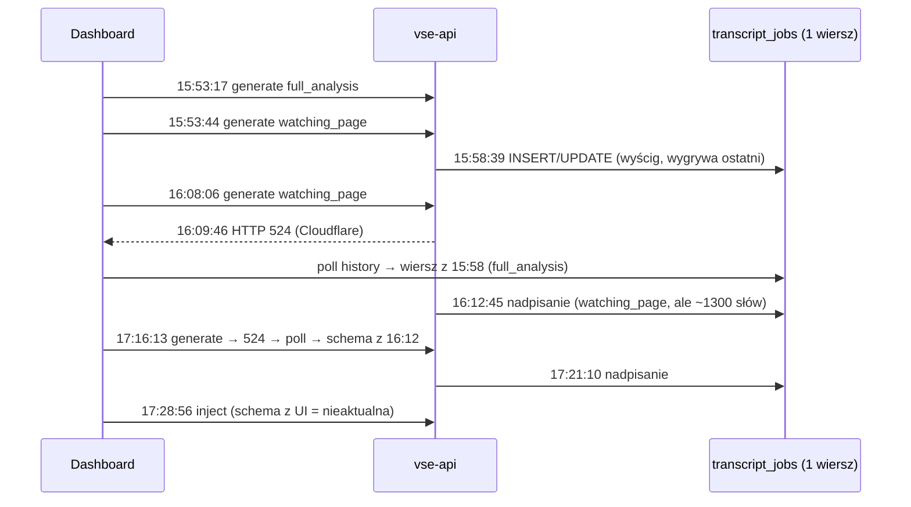
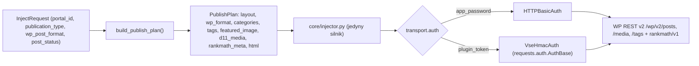

# Krytyczny Code & Architecture Review — VSE (second opinion do dossier `vse-analyst-02`)

**Recenzent:** Claude (vse-reviewer) · **Data:** 2026-10-20 · **Baza kodu:** `74e5218` (zweryfikowane: identyczna z `origin/main` w zakresie kodu)
**Metoda:** samodzielna lektura `generate.py`, `pipeline.py`, `generator.py` + surowe wycinki od 2 workerów research (inject/plugin/PHP/jobs/quota/dashboard).

---

## 0. Werdykt w 5 zdaniach

1. Diagnoza dossier jest **w ~80% trafna**: P1 (`clean_transcript`) i P2 (Pass 2 bez wariantu dla `watching_page`) wyjaśniają czas, a P3+P4 wyjaśniają podstawienie starego wyniku.
2. Dossier **pomija 3 mechanizmy, które realnie złożyły się na objawy** (wyścig dwóch równoległych generacji, Pass 2 nadpisujący Pass 1 *zawsze*, zależność `run_inject` od tego samego zepsutego rekordu joba) oraz **5 problemów bezpieczeństwa/skalowania**, z których 2 są krytyczne.
3. Dossier zawiera **3 błędy faktograficzne** w sekcji o publikacji (patrz §2) — plan K5 oparty na nich byłby częściowo chybiony.
4. **Plan K1–K5 ma ukrytą pułapkę:** K4 „zapisz transkrypt OAuth do `job.transcript`” bez zawężenia cache do użytkownika = **wyciek transkryptów filmów niepublicznych między tenantami**.
5. Kolejność wdrożenia musi być inna niż w dossier: K3 (frontend) bez K4 i bez async-joba zamieni „stary wynik” w „błąd po 200 s”.

---

## 1. Pytanie 1 — Czy 5 przyczyn wyjaśnia 100% objawów?

### 1.1 Co dossier wyjaśnia poprawnie
| Objaw | Przyczyna wg dossier | Ocena |
|---|---|---|
| S1 ~300 s spinner | P1 + P2 | ✅ potwierdzone: `max_tokens=8192` dla Claude, **brak sprawdzenia `stop_reason`** ([generator.py L344-359](file:///c:/Users/tomas2/.gemini/antigravity/playground/video-seo-engine/core/generator.py#L344-L359)), więc ucięcie jest ciche |
| S2 brak nowych wpisów historii | P4 (`"done"` w filtrze) | ✅ potwierdzone ([generate.py L83-96](file:///c:/Users/tomas2/.gemini/antigravity/playground/video-seo-engine/api/routers/generate.py#L83-L96)) |
| S3 stary wynik | P3 (brak `created_at`) | ✅ ale **niepełne** — patrz 1.2-A |
| S4 okrojony post | P5 | ⚠️ częściowo — patrz §2 |

### 1.2 Mechanizmy pominięte w dossier

**A. Wyścig dwóch równoległych generacji (15:53).**
Dane z `usage_logs`: ID 29 (`full_analysis`) start 15:53:17 + 322 s = **15:58:39**; ID 28 (`watching_page`) start 15:53:44 + 295 s = **15:58:39**; rekord joba `created_at` = **15:58:39.405**. Oba żądania kończą się w tej samej sekundzie i oba piszą do *jednego* wiersza (brak unique, brak `job_id`, „ostatni zapis wygrywa”). Dlatego rekord, który później podała pętla 524, zawierał `full_analysis` — **to nie był „wynik sprzed godzin”, tylko przegrany wyścig sprzed 10 minut**.
> Uwaga: `usage_logs.created_at` to najpewniej `now()` Postgresa = **start transakcji**, a nie koniec (sesja `get_db` jest otwierana w `check_quota`). To tłumaczy „odwróconą” kolejność ID 28/29. Kolejność zapisów można potwierdzić logami `Saved schema_data to existing job` z 15:58:39.

**B. Pass 2 uruchamia się ZAWSZE i nadpisuje `article_body`** ([generator.py L1398-1427](file:///c:/Users/tomas2/.gemini/antigravity/playground/video-seo-engine/core/generator.py#L1398-L1427)). Override `watching_page` w Pass 1 („MAX 2 krótkie akapity”, [L607-623](file:///c:/Users/tomas2/.gemini/antigravity/playground/video-seo-engine/core/generator.py#L607-L623)) to **martwy kod** — schemat JSON Pass 1 nawet nie ma pola `article_body` (L815). Nazwa `_generate_article_fallback` wprowadza w błąd: to jedyny silnik artykułu (PressAI jest wyłączony flagą).

**C. Obcięty `clean_transcript` jest akceptowany.** Pole jest ostatnie w JSON; po ucięciu na 8192 tokenach `json-repair` zostawia fragment, a warunek `len >= 50` ([L1322-1326](file:///c:/Users/tomas2/.gemini/antigravity/playground/video-seo-engine/core/generator.py#L1322-L1326)) go przyjmuje. Zakładka „Transkrypcja” pokazuje wtedy np. tylko pierwsze ~15 minut, a bezpiecznik w Pythonie się nie uruchamia.

**D. `run_inject` wybiera profil portalu przez „ostatni `TranscriptJob` dla `video_id`” → `job.portal_id`** (pipeline.py ~L1394-1410), a nie przez `req.portal_id`. Czyli **P4 psuje także ścieżkę `app_password`**: nadpisany/cudzy rekord = zły profil lub jego brak.

**E. Trzy przyczyny „długiego artykułu” w poście 128625**, nie jedna: (1) Pass 2 z „minimum 400 słów”, (2) nieaktualny schema podany przez pętlę 524, (3) sztywny layout `post_format="full_article"` w [inject.py L104-110](file:///c:/Users/tomas2/.gemini/antigravity/playground/video-seo-engine/api/routers/inject.py#L104-L110).

### 1.3 Ukryte zależności i warunki wyścigu (dossier ich nie wymienia)

| # | Problem | Waga | Dowód |
|---|---|---|---|
| R1 | **`_save_schema_to_job` nie filtruje po `user_id`** — użytkownik B nadpisuje historię użytkownika A dla tego samego filmu (`user_id` ustawiany tylko gdy `None`) | 🔴 | generate.py L83-96 |
| R2 | **Cache transkryptów jest globalny** (`_get_cached_transcript_from_db` bez `user_id`). Dziś wycieka „tylko” cache Runnera; po K4 (zapis transkryptów OAuth) wyciekną napisy filmów **unlisted/prywatnych** pobrane tokenem innego klienta | 🔴 | pipeline.py L188-211 |
| R3 | **Sesja DB trzymana 300 s** — `check_quota` otwiera transakcję (SELECT count), a ta sama sesja z `Depends(get_db)` czeka na `log_usage` po LLM. Połączenia w stanie „idle in transaction” wyczerpują pulę → polling `/history` (który *ma ratować* 524) też się blokuje | 🟠 | quota.py L101-151, generate.py L124-181 |
| R4 | **Domyślny executor `asyncio.to_thread`** = `min(32, CPU+4)` → na ARM z 4 rdzeniami ~8 wątków. Każda generacja blokuje wątek na ~300 s (synchroniczny SDK + `loop.run_until_complete` w wątku). 8 równoległych generacji = zawieszone **wszystkie** wywołania `to_thread` w API | 🟠 | pipeline.py L822/1096, generator.py L1403-1411 |
| R5 | **Quota nie jest atomowa (TOCTOU)** — limit jest liczony z `usage_logs` dopisywanych po fakcie; równoległe kliknięcia przechodzą kontrolę | 🟡 | quota.py L127-137 |
| R6 | **Płatność za wynik niedostarczony** — po 524 backend kończy pracę i nalicza kredyt + koszt (4 przebiegi ≈ 0,97 USD za jedną intencję). Brak klucza idempotencji | 🟡 | usage_logs §2.1 dossier |
| R7 | **Wyczerpanie okna pollingu** — pętla trwa 25×4 s = 100 s, czyli łącznie ~200 s od kliknięcia, a backend potrzebuje ~300 s. Po samej poprawce K3 użytkownik dostanie **błąd**, nie wynik | 🟡 | dashboard-inner.tsx L494-521 |

---

## 2. Błędy faktograficzne w dossier (sekcja 4.5 / K5)

1. **`profiles/prawy.yaml` NIE zawiera kategorii.** Kategorie `[2, 2472]` to **hardcode** `if "prawy.pl" in wp_base_url` w `_create_wp_post` (pipeline.py ~L1308-1314). „Załadowanie profilu” w ścieżce wtyczki niczego tu nie da.
2. **`core/injector.py` nie ustawia formatu, kategorii ani tagów.** Format i kategorie ustawia tylko `_create_wp_post` i **tylko przy tworzeniu posta** (`wp_post_id is None`). Przy aktualizacji (`inject_video`) nie ustawia ich żadna ścieżka.
3. **Tagi nigdy nie były obsługiwane** w żadnej ścieżce — to nie regresja, tylko brakująca funkcja. (WP REST wymaga ID tagów, więc trzeba je rozwiązać lub utworzyć po nazwie.)
4. Sztywne `publication_type="full_analysis"` w [plugin.py L768-776](file:///c:/Users/tomas2/.gemini/antigravity/playground/video-seo-engine/api/routers/plugin.py#L768-L776) dotyczy przepływu **inicjowanego z WP** (`/inject-data`), nie Dashboardu. To realny brak, ale **nie jest przyczyną** posta 128625.

---

## 3. Znaleziska bezpieczeństwa w ścieżce wtyczki (poza zakresem dossier)

| # | Problem | Waga |
|---|---|---|
| SEC1 | **Hash klucza przechowywany w DB VSE *jest* poświadczeniem do WordPressa klienta.** Wtyczka akceptuje `X-VSE-Key-Hash == sha256(key)` ([vse-video-seo.php L619-626](file:///c:/Users/tomas2/.gemini/antigravity/playground/video-seo-engine/plugins/vse-video-seo/vse-video-seo.php#L619-L626)), a VSE wysyła `api_key_obj.key_hash` z bazy. Hashowanie kluczy w DB traci więc sens: wyciek bazy lub backupu = możliwość publikacji na **wszystkich** portalach klientów jako domyślny autor. Do tego token jest statyczny (bez timestampu i nonce), więc można go odtworzyć (replay) | 🔴 |
| SEC2 | **Fallback `api_key_obj = all_keys[0]`** ([inject.py L81-82](file:///c:/Users/tomas2/.gemini/antigravity/playground/video-seo-engine/api/routers/inject.py#L81-L82)) — gdy klucz nie pasuje do domeny, VSE wysyła klucz portalu A na URL portalu B. U agencji z wieloma klientami to **ujawnienie poświadczenia osobie trzeciej** | 🔴 |
| SEC3 | `post_content` trafia do `wp_insert_post` jako domyślny autor; jeśli ma on `unfiltered_html`, każdy posiadacz hasha może wstrzyknąć dowolny JS (razem z SEC1 daje to stored XSS na portalu) | 🟠 |
| SEC4 | Fałszywe raportowanie: `"rankmath_ok": True` i `seo_score: 96` są wpisane na sztywno | 🟡 |
| SEC5 | Ciche przełączanie ścieżki: puste `wp_app_password` automatycznie wybiera `plugin_token` (inject.py L301) | 🟡 |

**Hotfix SEC2 to jedna linia** (usunąć fallback, wymagać `portal.api_key_id`) — zalecam przed jakimkolwiek innym krokiem.

---

## 4. Pytanie 2 — Cykl życia `TranscriptJob`: rozdzielić czy „nowy job + kopia”?

**Rekomendacja: oba, etapami. „Nowy job per przebieg” to krok 1 docelowego rozdziału, a nie alternatywa.**

### Etap 1 — hotfix (bez migracji schematu, 1 dispatch)
- `run_generate()` na starcie tworzy **nowy** wiersz (`status="processing"`, `user_id`, `portal_id`) i zwraca `job_id`, który przechodzi przez cały pipeline. `_save_schema_to_job(job_id, …)` aktualizuje **po PK**; wyszukiwanie po URL jest usunięte.
- **Nie kopiować transkryptu do każdego przebiegu** (185 KB × N kliknięć). Wystarczy zapisać go raz w rekordzie-źródle (np. pierwszy wiersz z transkryptem), a do przebiegu dopisać tylko `transcript_source` (`oauth|cache|runner`).
- Każde zapytanie cache i zapisu **musi** mieć zakres `user_id` (R1, R2) — **warunek wstępny K4**, nie dodatek.
- Dodać kolumnę `publication_type` (dziś historia nie wie, jaki typ wygenerowano).

### Etap 2 — docelowo (1–2 tygodnie, z migracją)
- **`transcript_jobs` wraca do swojej pierwotnej roli** (kolejka Local Runnera + cache): kolumna `video_id` z indeksem (dziś jest `LIKE '%id%'` = skan całej tabeli), `lang`, `source`, `fetched_at`, zakres dostępu (`scope='public'` → globalny; `unlisted/private` → `owner_user_id` / `channel_id`), unique `(video_id, lang, scope_key)`.
- **Nowa tabela `generations`** = historia (`user_id`, `portal_id`, `publication_type`, `status`, `request_id` UNIQUE, `schema_data`, tokeny, koszt, czasy per pass, `transcript_ref`).
- Backfill: istniejące wiersze z `schema_data` → `generations`. Endpointy `/v1/jobs/history` i `/v1/jobs/{id}` czytają z `generations`.

**Ryzyko refaktoru:** umiarkowane. Głównym kosztem są konsumenci `transcript_jobs` (Runner, historia, `run_inject`, pętla 524). Etap 1 usuwa 100% obecnych objawów bez migracji, więc Etap 2 można zrobić spokojnie.

---

## 5. Pytanie 3 — Timeout Cloudflare 100 s: przełączyć „Generuj” na SSE?

**Nie na obecny `/v1/generate/stream`. Rekomendacja: `202 Accepted + job_id + polling` jako kręgosłup. SSE ewentualnie później jako warstwa postępu.**

Dlaczego nie istniejący endpoint SSE:
1. Wysyła **jedno** zdarzenie `stage`, a potem milczy ~300 s. Bez heartbeatu co ~15–20 s Cloudflare i proxy mogą zerwać bezczynne połączenie.
2. nginx ma domyślnie `proxy_buffering on` (w repo nie ma ustawienia; `proxy_read_timeout 300s`). Bez `X-Accel-Buffering: no` zdarzenia utkną w buforze.
3. **Rozłączenie klienta anuluje generator** → `run_generate` dostaje `CancelledError` po tym, jak LLM już zapłacono. Wątek `to_thread` dalej pracuje, ale `_save_schema_to_job` i `log_usage` się nie wykonają, więc **wynik ginie, a koszt zostaje**.
4. Wynik jest powiązany z połączeniem: odświeżenie strony lub zmiana sieci w mobile = utrata wyniku.

Dlaczego 202 + polling:
- Wynik jest trwały (DB), przeżywa reload, ponowienie z kluczem idempotencji jest bezpieczne, a ten sam mechanizm obsłuży Dashboard i wtyczkę WP.
- **Wymaga etapu 1 z §4** (`job_id` na starcie), więc nie jest to dodatkowa praca, tylko naturalne domknięcie K4.
- **Zastępuje pętlę 524 w całości.** Poprawka K3 (`created_at >= requestStartTime`) staje się zbędna, i dobrze, bo porównuje zegar klienta z zegarem serwera (rozjazd zegarów). Gdyby K3 miała zostać przejściowo, lepiej, by klient wysyłał `request_id` (UUID), a polling pytał o job po tym `request_id`.

Uwagi wykonawcze:
- Wykonanie w tle: `asyncio.create_task` w procesie uvicorn wystarczy na obecną skalę, **pod warunkiem** dodania przy starcie sweepera, który oznacza osierocone `processing` (>10 min) jako `failed`. Docelowo osobny worker (arq/RQ).
- Rozdzielić sesję DB: krótka transakcja na quota/rezerwację, osobna na zapis wyniku (R3). Quota rezerwowana atomowo przy przyjęciu joba (R5).
- Własny `ThreadPoolExecutor` z limitem (np. 4) wyłącznie dla LLM, żeby generacje nie blokowały reszty API (R4).

Czy robić to **od razu**? Tak, w jednym sprincie z K4. Po K1+K2 `watching_page` zejdzie do ~25–40 s, więc nie ma pożaru. Ale `full_analysis` dla 2 h materiału (Pass 1 ~120k znaków wejścia + Pass 2 ~1500 słów) realnie zbliży się do 100 s, a darmowe plany na Gemini bez `max_output_tokens` mają ten sam problem.

---

## 6. Pytanie 4 — Unifikacja publikacji WP

**Rekomendacja: jeden silnik orkiestracji w Pythonie + wymienny transport uwierzytelnienia. Wtyczka staje się mostkiem auth dla WP REST v2, a nie drugim silnikiem publikacji.**

### Architektura docelowa

### Dlaczego ta opcja, a nie „wzbogacić `/vse/v1/publish`”
- `core/injector.py` już wszędzie używa `auth=auth` (`_make_auth`, L176). Podmiana na `AuthBase`, który podpisuje żądanie, to **minimalna zmiana w silniku** i przenosi naraz wszystkie dopracowane funkcje (D1–D15, miniatura, D11, RankMath).
- Rozbudowa PHP = **dwa silniki na zawsze**: każda przyszła funkcja (np. D16) do zrobienia w Pythonie i w PHP, z różnicami między wersjami wtyczki u klientów.
- Nagłówki `X-VSE-*` omijają hostingi, które usuwają `Authorization` (to prawdopodobnie pierwotny powód tokenu wtyczki), więc zachowujemy tę zaletę.

### Zmiany konkretne
1. **Wtyczka:** filtr `determine_current_user`, który weryfikuje `X-VSE-Signature = HMAC-SHA256(secret, METHOD|PATH|TS|NONCE|sha256(body))`, okno ±300 s, nonce w transientach (anty-replay), mapowanie na wyznaczonego użytkownika „VSE Publisher” z rolą *Editor* (bez `unfiltered_html` → zamyka SEC3; player JS musi trafić do szablonu lub shortcode zamiast inline `<script>`).
2. **VSE:** osobny `publish_secret` szyfrowany w spoczynku (Fernet/KMS), **nie** hash z tabeli `api_keys` (zamyka SEC1). Ścisłe powiązanie `portal.api_key_id`, bez fallbacku (SEC2).
3. **`build_publish_plan()`** z jednego źródła prawdy: profil przez `req.portal_id → portal.profile_id` (nie przez ostatni job, §1.2-D). Kategorie z profilu **lub z kolumny `WpPortal.default_categories`** — profile YAML nie skalują się na klientów SaaS bez dostępu do repo; hardcode `prawy.pl` usunąć.
4. **Rozdzielić nazwy:** `layout` (`full_article|watching_page|…` — struktura HTML) ≠ `wp_post_format` (`standard|video` — taksonomia WP). Dziś oba nazywają się `post_format` i to jest źródło błędu z L109.
5. Format i kategorie ustawiać **także przy aktualizacji** posta, nie tylko przy tworzeniu. Tagi: rozwiązanie nazw na ID przez `/wp/v2/tags?search=` z utworzeniem brakujących.
6. `/vse/v1/publish` zostaje jako **deprecated** dla starszych wersji wtyczki, z ostrzeżeniem w UI („zaktualizuj wtyczkę, aby mieć miniatury i kategorie”).
7. Test kontraktowy: ten sam `PublishPlan` puszczony przez oba transporty przeciw testowemu WP → identyczny wynik `GET /wp/v2/posts/{id}` (format, kategorie, `featured_media`, liczba mediów, meta RankMath).

---

## 7. Odniesienie do pytań kontrolnych dossier (§6)

- **Q4 `clean_transcript`:** wersja w Pythonie **wystarcza jako domyślna** (0 tokenów). Korekta ASR przez LLM tylko **na żądanie** (przycisk „Popraw transkrypcję” w zakładce): w tle, w kawałkach po ~5 min równolegle, tańszym modelem (Haiku/Flash), z cache po hashu transkryptu. Drobna uwaga: regex deduplikacji `\b(\w+)(?:\s+\1\b)+` usuwa także celowe powtórzenia („bardzo, bardzo”). Akceptowalne, ale warto o tym wiedzieć.
- **Ulepszenie K2:** dla `watching_page` **pominąć Pass 2 całkowicie** — dodać `article_body` (2 akapity) do schematu Pass 1 tylko dla tego typu. Jedno wywołanie LLM zamiast dwóch; override z L607 przestaje być martwy.
- **Do K1 dopisać obowiązkowo:** sprawdzanie `stop_reason == "max_tokens"` (log + flaga `partial_result`), `max_output_tokens` dla Gemini, logowanie czasu i tokenów **per pass**.

## 8. Skorygowana kolejność wdrożenia

| Krok | Zakres | Zależność | Kryterium akceptacji |
|---|---|---|---|
| **H0** | SEC2 (usunąć fallback klucza) | — | brak wysyłki klucza na obcą domenę |
| **K1+K2** | generator: bez `clean_transcript` w LLM, `stop_reason`, `watching_page` jednym przebiegiem, Pass 2 dla innych typów bez słowa „minimum” | — | `watching_page` 28 min < 40 s; `full_analysis` 28 min < 70 s |
| **K4** | `job_id` od startu, zapis po PK, zakres `user_id` w cache i zapisie, `publication_type` w rekordzie | przed K3 | 1 klik = 1 wiersz; brak odczytów między użytkownikami |
| **K3'** | 202 + polling `job_id` (zamiast poprawiania pętli 524), klucz idempotencji, osobny executor LLM, krótkie sesje DB | K4 | brak 524; reload nie gubi wyniku |
| **K5'** | auth bridge HMAC + `PublishPlan` + kategorie w DB portalu; `/publish` deprecated | H0 | test kontraktowy: oba `auth_mode` dają identyczny post |
| **E2** | rozdział `generations` / `transcript_cache` | K4 | backfill bez utraty historii |

> [!IMPORTANT]
> Decyzje dla Właściciela: (1) zgoda na 202+polling zamiast SSE, (2) zgoda na auth bridge + rolę *Editor* bez `unfiltered_html` (wymaga przeniesienia JS playera do wtyczki), (3) priorytet H0/SEC1 przed funkcjami.
